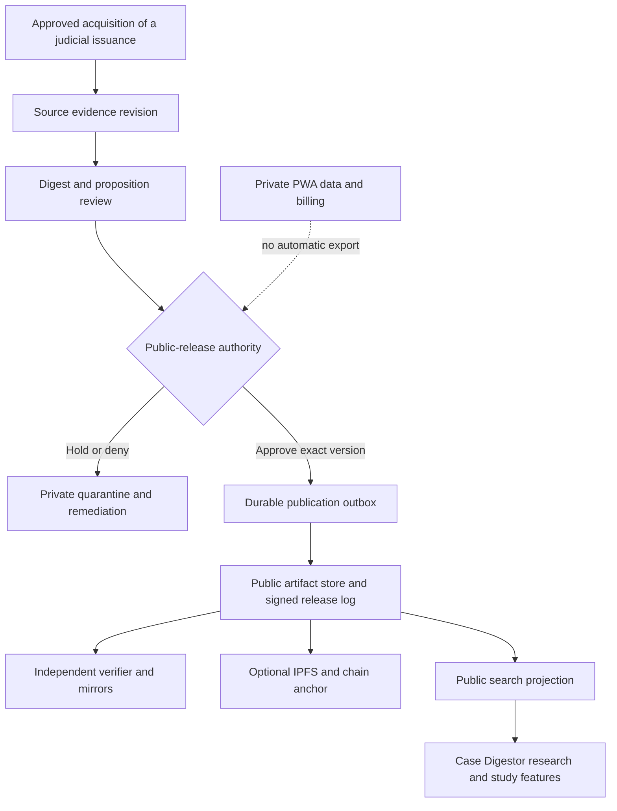

# Architecture decision proposal: public releases before federation

**20 October 2026 · Proposed ADR-001 · No implementation or production approval**

This proposal follows the [audit](audits/2026-10-20-independent-audit.md). It does not silently change the binding `AGENTS.md` stack or authorize a PWA migration. Cosmos/IPFS remain a possible anchoring target. Adopting a different permanent protocol architecture requires an explicit later architecture decision.

## Decision and scope

Keep the existing PWA database authoritative for personal work, authorization, billing and learning workflows. Introduce a separately approved, versioned public-release boundary. Prove source quality, review usefulness, reproducibility and economics before adding a production appchain.

Initially establish the signed-artifact baseline. After product evidence and a separately budgeted institutional-needs investigation, compare a witnessed release log against a corrected Cosmos anchoring prototype in isolation. Do not schedule chain-first PWA writes as an inevitable maturity step. There is no demonstrated requirement for the commons to own private PWA state.

### Drivers

1. Protect existing personal, annual-edition and financial invariants.
2. Make the legal evidence and review process independently inspectable.
3. Spend engineering and editorial capacity on measurable user outcomes.

### Alternatives

| Option | What it provides | Cost and limitation | Recommendation |
|---|---|---|---|
| Versioned database and signed downloadable manifests | Fastest test of identity, review and export | Operator can omit history or present conflicting histories without external observation | Minimum baseline; do not call it decentralized |
| Append-only Merkle log, independent witnesses and mirrors | Inclusion/consistency checks and detectable equivocation | Witness operation, key lifecycle and availability still require engineering; does not provide consensus on legal correctness | Preferred next experiment |
| Cosmos appchain anchoring approved releases | Shared ordering and governance among independent operators | Keeper/security/upgrade work, validator operations, spam control and durable indexing | Conditional pilot after independent demand and funding |
| Chain-first replacement for PWA writes | Single consensus-ordered public state | Conflicts with private state, latency isolation, withdrawal and existing billing/owner-write controls | Reject for current scope |
| Anchor batches to an existing public network | External timestamp/settlement without running validators | Operator cost, external assumptions and dependency remain even when end users pay nothing | Future comparator; no new EVM implementation authorized |

The best argument for an appchain is institutional independence: multiple organizations may need to write and verify a shared history without trusting the founder's database. If they need only evidence exports and mirrors, running consensus may solve the wrong problem.

## Trust and data boundaries

The diagram is proposed behavior, not a description of deployed code.

The public-release operation is distinct from a personal save, corpus-contribution approval, premium entitlement, public-share toggle, or canonical-library reuse. It needs its own authority and an allowlist of fields. A broadly privileged reader of PWA tables is not a suitable boundary.

In the existing PWA, the canonical authority design already describes a public-safe source class and HOLD behavior. Resolve that authority's outstanding gates before integrating it. A separate pilot can use newly acquired, independently reviewed public material without treating legacy PWA rows as certified.

## Proposed domain model

| Object | Identity and required evidence |
|---|---|
| Judicial issuance | Stable reviewed ID; court; docket set; issuance kind; promulgation date; majority/separate-opinion relationship; source-acquisition evidence. Docket and date are matching attributes, not sufficient identity |
| Source artifact revision | Exact raw-byte hash; media type; acquisition URL/time; rights/privacy decision; extraction version; page/paragraph map; relation to earlier source versions |
| Digest revision | Immutable revision ID; source revision references; content hash; schema version; AI involvement; author attribution policy; license decision |
| Legal proposition | Scoped statement; exact supporting passage and locator; opinion type; temporal/context qualifiers; relation to digest revision |
| Review | Exact target revision/proposition; rubric version; reviewer credential reference; findings and evidence; conflict declaration; authenticated signature; review time; expiry/recheck policy |
| Citation treatment assertion | Citing issuance and passage; cited proposition; relation; rationale; certainty/dispute status; reviewer evidence; adjudication history |
| Public release | Release ID; exact artifact hashes; schema/license/policy versions; public-safe review references; supersession/withdrawal references; release signer and key ID |
| Anchor receipt | Release commitment; network/log ID; transaction or tree location; confirmation evidence; observed time; verifier version |

Prefer immutable revision IDs plus separately verified content hashes. If IDs themselves are content-derived, specify domain separation and canonical encoding exactly. Use a schema migration plan; “chain-ready” does not eliminate migrations.

Identity mapping is an editorial/security decision. Two files with identical text may have different source histories; two official representations of one issuance may have different byte hashes. Neither collapse nor duplication should be automatic.

## Review and legal treatment are separate axes

Do not collapse everything into `AI_DRAFT -> COMMUNITY_REVIEW -> BAR_ATTESTED -> MODIFIED_OR_ABANDONED`.

- **Review:** draft, in review, reviewed, disputed, withdrawn.
- **Source:** observed, corroborated, reviewed identity, hold, denied.
- **Publication:** private, approved, published, quarantined, superseded.
- **Treatment:** asserted relationship for a specific proposition and citing passage, with its own review status.
- **Integrity/availability:** verified bytes, unavailable, mismatch, unverified.

Examples:

- A correctly reviewed digest can describe a doctrine later modified. Its review history remains valid for the version and scope reviewed.
- Distinguishing a case need not abandon its doctrine.
- A reversal of a disposition is not necessarily reversal of a doctrinal proposition.
- A dissent's language does not become the holding because it is strongly worded.
- One new decision can affect one proposition while leaving others useful.

Constitutional authority constraints must be reflected in review validation; see [L1](SOURCE_REGISTER.md). No model or voting rule alone determines legal validity.

Use user-facing wording such as **“Reviewed on [date]; scope and reviewers”**, **“Source bytes verified”**, and **“Later treatment checked through [date] within [coverage]”**. Avoid a composite “verified doctrine” seal. Keep `BAR_ATTESTED` only as a legacy prototype identifier until its replacement is specified.

## Deterministic encoding and signatures

Freeze a versioned payload schema before publishing durable commitments. Define UTF-8, canonicalization version, date/time representation, optional versus absent fields, array ordering, integer bounds, escaping, invalid Unicode and duplicate-key rejection. Use fixed-point integers or strings where precision matters. No locale-sensitive transformations.

Require independent Python/Go/TypeScript golden vectors and RFC 8785 edge cases before claiming JCS compliance. Raw PDFs are hashed as received; extracted or normalized text gets a separate hash and extraction provenance. Specify the IPFS importer profile if reproducible CIDs are required: chunking, codec, raw-leaf behavior and CID version can affect the CID. A UnixFS CID is not simply the raw file's SHA-256 string.

Reviews sign an envelope binding protocol/domain, exact revision, rubric, intended action, nonce, expiry and credential/key reference. Specify key compromise, rotation and revocation. Credential validity at review time and current credential status are different facts.

Passkeys need a tested bridge to the chosen transaction-signing model; “WebAuthn” does not by itself implement a Cosmos signer. Cosmos `authz` delegation, fee sponsorship and the reviewer's authorship signature are separate controls. A relayer executing delegated authority must not be presented as proof that the principal signed each review.

## Delivery, replay and correction

1. A public-release transaction creates an immutable release record and outbox item atomically. The release contains only approved public fields.
2. The worker reads the release, rechecks current publication eligibility, persists exact bytes, verifies them and publishes the approved artifact.
3. Record independent durable states: pending, stored, pinned, anchor submitted, confirmed, indexed, held, retryable failure. Never derive “confirmed” from a broadcast attempt.
4. Use release ID plus destination as the idempotency key. Persist transaction intent/hash before ambiguous network retries; reconcile receipts before resubmission.
5. Use at-least-once delivery with deduplicated effects. Retry only retryable failures with bounded backoff; hold denied, revoked or invalid releases for explicit remediation. Replaying an export must never reserve credits, reward a contribution or mutate an owner's digest.
6. A WebSocket is a prompt to reconcile, not the complete database. Maintain a verified height/event cursor, backfill missed ranges, check transaction result codes, deduplicate `(network, height, tx index, event index)`, and rebuild projections from durable history.
7. Source corrections create new revisions; old attestations remain bound to the earlier version. Hold stale approvals pending review.
8. Withdrawal removes discovery and operator-served content where appropriate, publishes a minimal safe tombstone, and records the decision. It cannot guarantee erasure of copies already replicated publicly.

Publication and withdrawal must serialize on an exact release version. Once bytes have left the controlled system, a last-second consent reversal cannot reliably recall them; the UI and operational policy must explain that boundary.

Keep raw released artifacts separate from mutable search projections and embeddings. Content changes invalidate derived artifacts explicitly. Choose the first implementation's storage and queue from existing supported components; do not add dependencies merely to satisfy this document.

## Threats and acceptance tests

| Threat | Required evidence and stage |
|---|---|
| Unverified source or wrong issuance | Ambiguous same-docket/date, later resolution and separate-opinion fixtures hold; exact approved source succeeds |
| Private-data export | Canary private fields, uploads, annual assignments and identity documents never appear in release, log, public storage, queue logs or RPC payload |
| Forged/replayed reviewer | Pilot: reject new submissions with invalid signer, revoked key, expired credential, duplicate reviewer or wrong-version signature; retain historical status-at-signing evidence and display later revocation/compromise separately |
| Collusion and score gaming | Calibration cases, conflict review, rate limits and sampled independent adjudication; agreement alone is insufficient |
| Silent rewrite or split history | Pilot: altered signed artifacts/manifests fail verification and independent readers retain snapshots. Later witnessed-log gate: inclusion/consistency proofs verify and independent witnesses detect conflicting checkpoints. An unwitnessed operator can still omit or fork history |
| Outage or lost response | Crash at every delivery stage, duplicate event, disconnected subscriber and uncertain broadcast recover without loss or double effects |
| Incorrect legal certainty | Disputed and unknown coverage visible; negative-treatment fixtures never become an automatic “good law” badge |
| Resource exhaustion | Size/depth/message-count limits; role quotas; bounded gas/work; block limits; sponsor caps; IPFS fetch limits and timeouts |
| Unsafe public storage | Publication screening and withdrawal drill; IPFS administrative API isolated from public access |
| Operator disappearance | Third party restores a released snapshot and verifies history without the PWA |

## Conditional chain gate

Only revisit a production Cosmos anchoring service when at least four genuinely independent, appropriately weighted operators have agreed to a funded governance/operations arrangement, the shared-writer need is documented, and a security-reviewed implementation passes signed transaction, authorization, persistent-state, replay, upgrade and loss-of-validator drills.

Four equal-power validators are a planning minimum for tolerating one faulty operator under the usual less-than-one-third assumption; it is not a guarantee of independence or resilience. Three equal-power validators need all three for more than two-thirds voting power, so one offline participant can halt progress. Two institutions are useful editorial partners, not proof of Byzantine fault tolerance.

No mandatory token economics, CosmWasm escrow, IBC, notarial registry or property-title expansion is part of the initial product. Reassess those as separate investments only after their own need, authority, economics and privacy constraints are demonstrated.

For any chain candidate, require explicit state-commitment tests: independently mutate every persisted consensus-state field and observe the expected commitment change; reproduce identical commitments from identical histories across validators and restarts; and prove failed transactions leave application state unchanged. These tests must catch the prototype's A02 omission, not merely compare block heights.

## Consequences and follow-ups

This choice delays a mainnet narrative and duplicates some prototype work. It reduces coupling to unverified consensus software and tests the human work that actually produces useful legal evidence. The chain may remain an experiment indefinitely without making the commons a failure.

Follow-ups: domain schema ADR; source and content-rights inventory; credential and review policy; public-release authority design; canonicalization vectors; signed-log threat model; independent export verifier; outbox fault tests; benchmark and paid pilot. Owners and dates are in the [roadmap](EXECUTIVE_ROADMAP.md).
